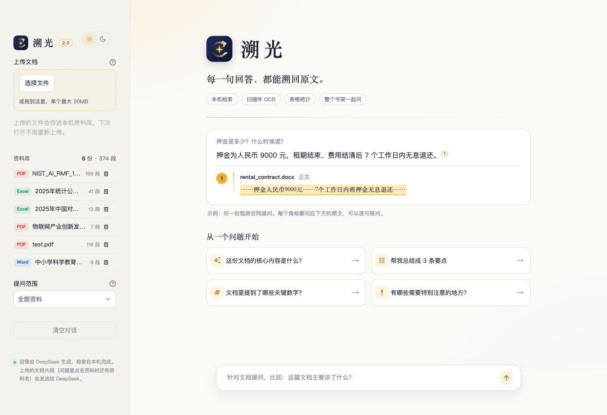
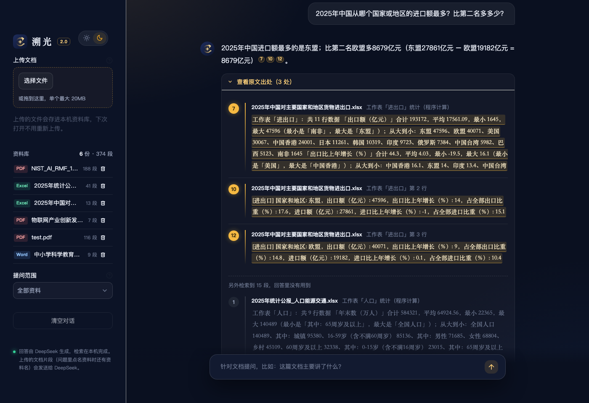
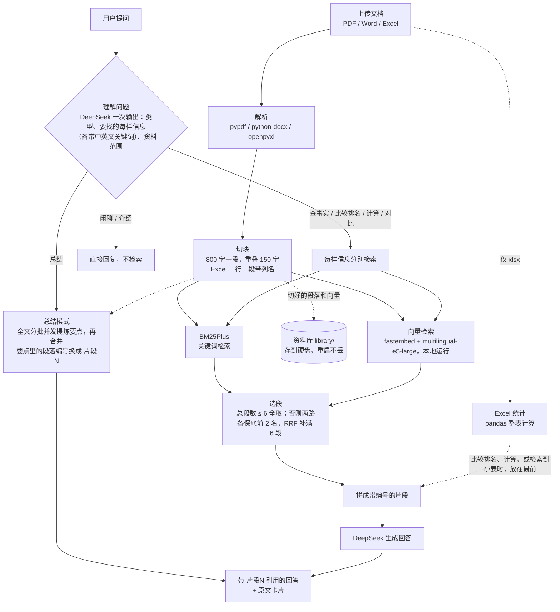

<div align="center">


# 溯光 Suguang

**每一句回答，都能溯回原文。**

把 PDF、Word、Excel 丢进来，直接用中文提问。溯光会从原文里找到依据再回答，每句话都标出处，点开就能核对。

**BM25 + 多语言向量 + RRF 混合检索 · pandas 精确统计**

开发过程和思考，我在 X 上连载：[@Yefan83](https://x.com/Yefan83)


</div>

| 欢迎页（白天模式）                           | 对话页（黑夜模式）：问表格里的数字，回答写出算式，每个数字都带出处角标 |
| ----------------------------------- | -------------------------------- |
|  |  |

> 两张都是本机实际运行截图（资料库里 6 份公开资料）。侧栏右上角 ☀ / ☾ 可以切换白天、黑夜。

---

## ✨ 功能亮点

- **🎯 句句有出处**：回答里的每个 `[片段N]` 会显示成小角标。点开下方「查看原文出处」，先列出回答**引用的原文**，用荧光笔高亮；检索到但没用上的片段颜色变淡，放在最后。
- **📄 三种格式**：PDF（包括无需打开密码的加密 PDF，以及扫描版 PDF）、Word（.docx，正文和表格）、Excel（.xlsx，多个工作表，按行切块并带上列名）。可以一次上传多份文件。
- **📚 能总结整份文档**：问"核心观点是什么""总结成 3 条要点"时进入总结模式。全文分批提炼要点，再合并成一个回答，要点尽量都标上出处。116 段的论文第一次约 7–9 秒，再问只要 3–4 秒。Excel 的总结会带上 pandas 算好的准确数字。
- **🗂️ 资料库**：上传一次就存在本机，下次打开不用重新上传。侧边栏列出全部资料，可以删除（会弹窗再确认一次）；"提问范围"里选几份，提问和总结就只在这几份里找，输入框会提示当前范围。
- **📌 问题里点名资料**：问"第一个文件讲了什么""NIST 那份里……""那篇英文论文的核心观点"时，这一问只在点名的资料里找，侧栏设置不变。程序先判断是不是真的点名了，没点名就不会乱选。
- **📊 表格会算数**：遇到"合计、平均、最多、最少、排名"这类问题，用 pandas 对整张表做精确计算（最大最小写明是哪一行，小表附完整排名），再交给模型组织语言，不靠模型心算。全程不执行 AI 生成的代码。
- **🌏 跨语言**：英文论文可以用中文问、中文答。关键词同时改写成中英文，向量模型也支持多语言。
- **🙅 不知道就说不知道**：文档里没有的内容，会回答"文档里没有提到"（评测里 5/5 正确拒答）。
- **💬 分得清闲聊**：说"你好""谢谢"不会去翻文档；问"你能做什么"会给出产品介绍。
- **🔗 链接直接提问**：打开 `http://localhost:8501/?q=你的问题`，页面加载后会自动提问，方便分享和演示。首页示例问题会按载入的文档类型变化（默认论文、纯 Excel、其他文档各一套）。
- **🔍 能读扫描件**：PDF 里读不出字的页，会渲染成图片交给 OCR（rapidocr）识别，出处标成「第 N 页（扫描识别）」，提醒可能有个别错字。约每页 2 秒，每份资料只识别一次。
- **🛡️ 稳**：网络断开、超时、限流、Key 无效时，给出中文提示；坏文件、有密码的 PDF 只跳过它自己并说明原因；读取规则升级后，旧资料打开时自动按新规则重新处理，不用重新上传。

## 🏢 应用场景

| 场景         | 可以怎么用                                       |
| ---------- | ------------------------------------------- |
| 企业知识库      | 上传规章制度、报销流程、产品手册。新员工直接问"出差住宿标准是多少"，答案附带条款原文 |
| 客服助手       | 上传说明书和 FAQ，快速回答"C2 故障码什么意思""保修多久"           |
| 合同与法务      | 快速定位押金、违约金、期限、退租条款在第几条，减少漏看                 |
| Excel 数据问答 | "一季度谁卖得最多""3 月平均每单多少钱"，由程序精确计算              |
| 学习与科研      | 读英文论文、教材，不懂的地方用中文直接问，每个回答都能对照原文             |
| 行业报告       | 几十页的白皮书、蓝皮书，几秒找到关键数字和出处                     |

## 📈 评测

`eval.py` 用 6 份样本文档（Word 合同、Excel 销售表、中文说明书、中文行业蓝皮书、英文论文、自制扫描件）出了一套带标准答案的题，自动判分。它调用的是和网页完全相同的 `rag.answer()`。另外用 Streamlit `AppTest` 打开 app.py 提两个问题，检查页面不报错、回答带引用（只记录结果，不参与判分）。

| 项目                       | 改进前                    | 改进后（当前）                              |
| ------------------------ | ---------------------- | ------------------------------------ |
| 22 道带标准答案的文档题            | ✅ 17 / 🟡 1 / ❌ 4      | **✅ 22 / 🟡 0 / ❌ 0**                |
| 5 道"文档里没有"的题（应拒答）        | 5/5                    | 5/5                                  |
| 3 句闲聊（应不检索）              | 3/3                    | 3/3                                  |
| 2 道新增 Excel 统计题          | —                      | 2/2                                  |
| 3 道新增全文总结题               | —（旧版问"核心观点"时答"没有明确提到"） | 3/3                                  |
| 扫描版 PDF（自制）              | 页面崩溃                   | 2.0 起能 OCR 识别：3 道扫描件题答对；关掉 OCR 时友好提示 |
| 4 道书架题（多份资料放一起，问题里点名某一份） | —                      | 4/4                                  |

2.0 之后样本题共 40 道文档题 + 3 句闲聊；另有 38 个不调用 DeepSeek 的小测试（`tests/`），专门测资料库、OCR、点名资料这些容易改坏的地方。

题型覆盖：直接事实、同义改写（"保证金"对应"押金"）、中英跨语言、表格查找、汇总计算、全文总结、文档里没有的问题。总结题的判法：不能拒答，必须带 `[片段N]` 引用，必须提到"检索""生成"等关键概念；要求 3 条时就必须正好 3 条。

**我是怎么把 17/22 提到 22/22 的**：

| 错题              | 查出的原因                        | 改法                                                                                |
| --------------- | ---------------------------- | --------------------------------------------------------------------------------- |
| 押金是多少（合同只有 2 段） | 段数太少时 BM25 算出负分，被 `>0` 门槛过滤掉 | 换成 BM25Plus；≤6 段时全部交给模型                                                           |
| 英文问故障码 C2       | 关键词检索第 1 名在 RRF 融合后被挤掉       | 两路各保底前 2 名；每次给模型的段数从 4 提到 6                                                       |
| 英文问全球市场规模       | 同上，且证据段向量排第 29               | 当时答对了，但答案来自另一页（第 9 页），原证据段没被检索到，算"侥幸答对"。后来嵌入模型换成 multilingual-e5-large，原证据段也能检索到了 |
| 按订单号查明细         | Excel 按字数硬切，后面的段落丢了表头        | 一行一段、带上列名                                                                         |
| 一季度哪个产品卖得最少     | 模型只看到 6 段，按局部数据"估算"          | 新增 CALC 路线，用 pandas 算整张表                                                          |
| 扫描版 PDF         | 抽不出文字，切出 0 段，程序崩溃            | 检测后跳过并提示                                                                          |

**判分本身也查过漏洞**：最早的判法是"回答里出现某个字就算对"。可回答里本来就带 `[片段2]`，"几台空调"的标准答案恰好是"2"，就可能被误判为对。现在的判分会先去掉引用标注，数字按完整的数比较（`2` 不会命中 `12`、`2018`）。拒答必须是第一句就说"没有提到"，不再看全文里有没有"并未"二字。修完后重新跑，结果仍然是 22/22。判分代码也请 Claude Code 审查过。

> ⚠️ **说明局限**：这套题是开发过程中一直拿来对照的题，相当于"拿做过的卷子再考一遍"，分数会偏乐观，判分也以关键词匹配为主。
>
> 所以 2.0 又补了一批**开发时没见过的真实资料题**（46 道，用 5 份公开资料，题目只在本地），而且不只看答案，还分开考"问题理解对没对""需要的原文找没找到"，每道题跑 3 次。最近一次：理解 97%、原文找到 94%、答对 87%（33 道）和全部 100%（13 道）。过程见 [开发记录](docs/2.0/开发记录.md)。

## 🔍 原理



几个关键设计（数值都定义在 `rag.py` 顶部的常量里）：

- **先理解问题**：一次调用让 DeepSeek 输出结构化的理解：问题类型（查事实 / 比较排名 / 计算 / 总结 / 对比 / 闲聊）、要找的每样信息（计算题会把算式里的每个数分开列，各自检索）、资料范围。只在后台用，不显示给用户；格式不对时退回老办法。接下来的方向是**程序为主、模型为辅**：理解、表格计算这些环节逐步改由本地程序完成，模型只负责把程序选好的原文组织成通顺的回答。

- **两路检索互补**：BM25 擅长精确词（订单号、"C2"、数字）。中文用 rjieba 的搜索模式分词，长词和里面的短词都保留（"书面通知"→ 书面 / 通知 / 书面通知），问题和资料切法略有不同也能对上；对比实验里，五份文档混在一起时，证据被关键词检索排进前 6 的从 18 道升到 20 道（共 21 道）。向量检索擅长换说法（"免费修多久"对应"保修"）。用 RRF（`1/(60+名次)`，名次从 0 起）融合两个排名，再让两路各自的前 2 名一定入选，防止某一路的第一名被挤掉。

- **总结模式（map-reduce）**：按原文顺序把段落装成每批不超过 6000 字。最多 12 批，超出时每份文档至少保留 1 批，再在各自的批次里均匀挑选（一定包含第一批和最后一批）。然后 12 路并发让 DeepSeek 提炼每批要点，并标出依据的段落编号；再把所有要点合并成最终回答，编号换成页面认识的 `[片段N]`，模型编造的编号会被丢弃。每批要点按内容哈希缓存在内存里，同一份文档再问总结时不用重新提炼。只总结某一章、某一条款的问题仍走普通检索。

- **资料库（录入一次，以后随时问）**：上传的文件连同切好的段落和向量存进 `library/`。按文件内容的 sha256 判断是否录入过，只处理新文件；重启后不用重新上传。关键词索引（BM25）不存盘，每次启动现场重建，几万段也只要一两秒。存储层是 `rag.py` 里的 `FileStore`（文件夹 + json/npy），以后要换成 LanceDB、Chroma 等向量数据库，只需替换这一个类。打开 `DEMO_MODE` 时默认关闭（`PERSIST_LIBRARY`），因为那时所有访客共用一个应用。

- **嵌入模型**：本地默认用 `intfloat/multilingual-e5-large`（约 2.2GB，最长 512 token），800 字的段落基本能完整读到。换模型前做过对比实验：21 道带证据的题，单靠向量检索，证据排进前 6 的从 15 道升到 20 道；五份文档混在一起检索时，从 13 道升到 18 道。代价是计算向量慢很多（约 6 段/秒，原模型约 95 段/秒），好在每份资料只算一次。资料库发现存的向量是旧模型算的，会自动重算。可以用环境变量 `EMBED_MODEL` 换回小模型 `paraphrase-multilingual-MiniLM-L12-v2`（约 240MB）。

- **短文档不挑**：总段数 ≤ 6 时全部交给模型，避免小文档因为打分不稳定而漏掉答案。

- **引用可核对**：模型被要求在句末标 `[片段N]`。页面解析这些编号，只展开被引用的原文。

- **哪些在本机、哪些发给 DeepSeek**：解析、切块、向量计算都在本机完成。普通提问发给 DeepSeek 的是：你的问题（问题里点名资料时还有资料名）、被选中的几段原文；统计类问题还会附上 pandas 算好的整表汇总；**总结模式会把整份文档（较长时为均匀挑选的部分，最多约 7 万字）分批发给 DeepSeek**。

## 🚀 快速开始

需要 Python 3.12 和一个 [DeepSeek API Key](https://platform.deepseek.com/)。

```bash
git clone https://github.com/Xiao6621/suguang.git && cd suguang
python3.12 -m venv .venv && source .venv/bin/activate
pip install -r requirements.txt

cp .env.example .env        # 然后把 .env 里的 你的key 换成自己的 DeepSeek API Key
streamlit run app.py        # 浏览器打开 http://localhost:8501
```

- 第一次运行会自动下载约 2.2GB 的多语言嵌入模型（multilingual-e5-large），放到 `models/` 目录。之后嵌入模型离线运行，回答仍需联网调用 DeepSeek。电脑配置较低的话，可以在 `.env` 里加一行 `EMBED_MODEL=sentence-transformers/paraphrase-multilingual-MiniLM-L12-v2` 改用约 240MB 的小模型（检索效果会差一些）。
- 上传的文件会存进 `library/` 资料库，下次打开不用重新上传。在侧边栏的资料列表里可以删除单份资料；要一次清空，直接删掉 `library/` 文件夹即可。
- 没上传文件时，默认用 `test.pdf`（RAG 论文）演示。

运行评测（会调用 DeepSeek，全部跑完约 8 分钟）和小测试（不调 DeepSeek，约 1 秒）：

```bash
python eval.py              # 样本评测 + AppTest，结果写到 samples/eval_output.md
python eval.py --no-apptest # 只跑样本评测
python -m unittest discover tests -v
```

评测结果在本地生成，不放进仓库；成绩写在本页和开发记录里。

两份第三方 PDF 没有随仓库提供（见下方「样本与版权」）。缺失时会跳过对应的 10 道题，直接克隆运行看到的是其余题目的结果。

## 🗂️ 项目结构

```
kb-assistant/
├── app.py              # 网页界面（Streamlit）：上传、对话、角标、原文卡片
├── rag.py              # 核心逻辑：解析、切块、BM25 + 向量 + RRF、Excel 统计、理解问题、answer()
├── eval.py             # 自动评测：题库 + 判分 + AppTest
├── tests/              # 资料库、OCR、点名资料的小测试（不调 DeepSeek，约 1 秒）
├── requirements.txt
├── .env.example        # API Key 模板（真正的 .env 不进仓库）
├── .streamlit/         # 主题配置
├── assets/             # logo 和头像（make_assets.py 生成）
├── samples/            # 评测样本，以及生成样本的 make_samples.py、make_scan_sample.py
├── docs/               # 截图；docs/2.0/开发记录.md 是 2.0 的开发过程
├── test.pdf            # 默认演示文档
├── library/            # 资料库：录入的原文件、段落、向量（自动生成，不进仓库）
├── models/             # 嵌入模型缓存（自动下载，不进仓库）
├── LICENSE
└── step1.py ~ step3.py # 学习过程中的三个小练习：单次调用 → 整篇问答 → 切块检索
```

`rag.py` 不依赖 streamlit。网页和评测调用的是同一个 `answer()`，所以评测测到的就是用户实际用到的逻辑。

2.0 是怎么一步步做出来的（包括请另一个 AI 审查、再逐条核对修复的过程）：见 [docs/2.0/开发记录.md](docs/2.0/开发记录.md)。

## 🚧 已知局限

- **扫描件识别慢**：OCR 约每页 2 秒，几百页的扫描书第一次录入要等十分钟左右（录入时有进度条）。
- **总结的覆盖面**：总结模式最多看 12 批（每批约 5000–6000 字，相邻段落有重叠）。像 test.pdf 这样 116 段的论文已经要挑选批次，更长的文档细节会有遗漏；缓存只在内存里，重启后要重新提炼。
- **链接提问会花你的额度**：`?q=` 打开即提问，一个总结问题会调用约 14 次 DeepSeek。打开 `DEMO_MODE` 时默认关闭这个功能，由 `ALLOW_Q_PARAM` 控制。
- **超大表格**：统计结果会整段放进提示词，表多、列多时提示词会变得很长。
- **录入变慢**：e5-large 算向量比原来的小模型慢 15 倍左右，一本几百页的书第一次录入要一两分钟（之后存在资料库里，不用再算）。
- **不支持追问**：每次提问都是独立的，"那什么时候退？"里的"那"它不知道指什么。
- **歪斜的扫描件**：整页歪 0.3° 以上时，个别行会被认成乱码（端正的页面没问题）；行尾正好断在数字中间时不会接回一行。
- **中文问英文资料**：有的证据检索不到，比如问"哪一项是其他特征的基础"，原文写的是 "necessary condition"，关键词对不上。
- **Word 没有位置信息**：.docx 整份标成"正文"，出处没法定位到具体章节。

## 🗺️ 下一步计划

- [x] 总结模式：意图里新增 SUMMARY，分批总结再合并（map-reduce）
- [x] 资料持久化：录入一次存到硬盘，按内容哈希增量录入，重启不用重新上传
- [x] 换支持长文本的嵌入模型：对比了 4 个模型 × 4 种段落长度，选 multilingual-e5-large。实验里切小段（300–500 字）反而更差，所以段落仍是 800 字
- [x] 中文分词：BM25 改用 rjieba（jieba 的 Rust 版）搜索模式按词检索，代替按单字匹配
- [x] 资料库管理：页面上查看、删除资料，提问时可以指定"只在某本书里找"
- [x] 接入 OCR：用 pypdfium2 + rapidocr 识别扫描版 PDF
- [x] 问题里点名资料："第一个文件""NIST 那份"只在点名的资料里找
- [ ] 扩大评测（进行中）：开发时没见过的真实资料题，分开考理解、找到、答对，每题跑 3 次
- [ ] 程序为主、模型为辅：表格题本地匹配、本地计算、本地作答；问题理解改成本地优先，模型兜底
- [ ] 多轮追问：结合最近几轮对话，把问题改写成能单独理解的完整问题
- [ ] 流式输出，减少每次调用模型的次数

## 📚 样本与版权

自制样本 `rental_contract.docx`、`sales_2025Q1.xlsx`（由 `samples/make_samples.py` 生成）随仓库提供。

下面两份是第三方文档，版权归原作者，**没有放进仓库**。想完整复现评测，请自行下载到 `samples/` 目录（文件名保持一致）。没有这两份时，`eval.py` 会自动跳过对应的题。

| 文件名                             | 文档                   | 来源                                                                                     |
| ------------------------------- | -------------------- | -------------------------------------------------------------------------------------- |
| `philips_hd7000_manual.pdf`     | 飞利浦 HD7000 电饭煲说明书    | <https://dam.versuni.com/m/d70ad36a3179c94/original/KA_2025_HD7000_User-Manual-CN.pdf> |
| `caict_cloud_bluebook_2025.pdf` | 中国信通院《云计算蓝皮书（2025年）》 | <https://www.caict.ac.cn/kxyj/qwfb/bps/202507/P020250722583603558109.pdf>              |

其他样本：`rag_paper_en.pdf` / `test.pdf` 是 Lewis et al.,《Retrieval-Augmented Generation for Knowledge-Intensive NLP Tasks》（[arXiv:2005.11401](https://arxiv.org/abs/2005.11401)）；`scan_notice.pdf` 是自制的扫描件（虚构的书店年度工作安排，只有图片、没有文字层），由 `samples/make_scan_sample.py` 生成。

## 📄 License

代码以 [MIT License](LICENSE) 开源。
